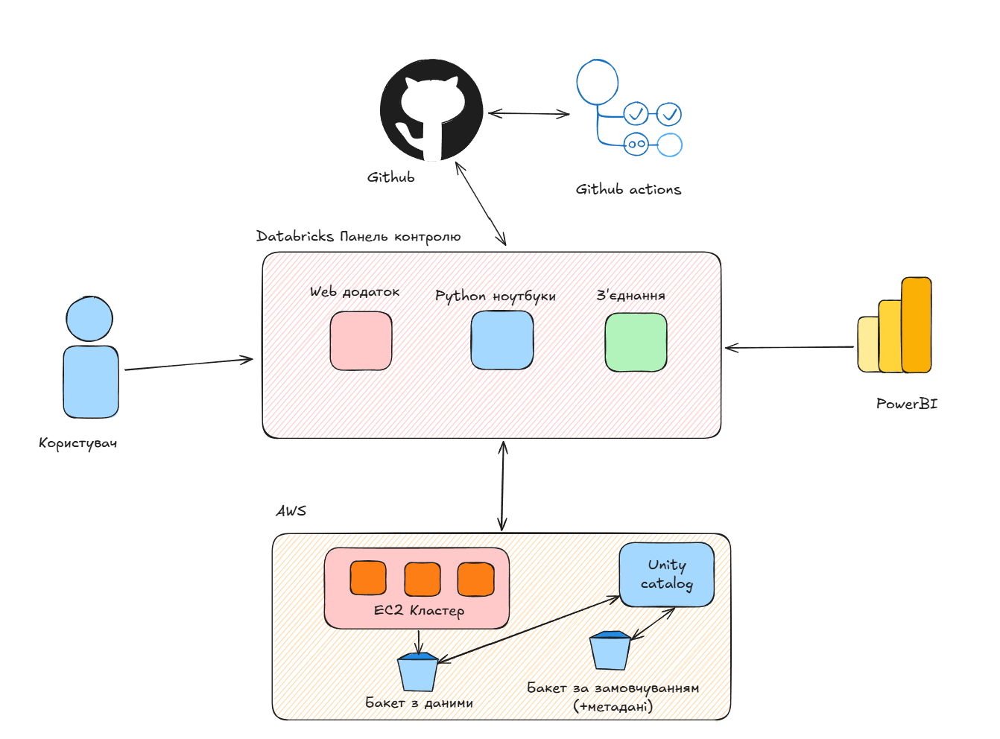

# Intro

This project is responsible for deploying AWS in Databricks using Terraform, and organizes the daily processing and visualization of weather data using DevOps and IAC approaches

# File structure

```
.
├── README.md
├── .github/workflows/
│   └── deploy.yml
├── databricks
│   ├── databricks.yml
│   └── process_weather.py
└── terraform
    ├── databricks.tf
    ├── iam.tf
    ├── outputs.tf
    ├── providers.tf
    ├── root_storage.tf
    ├── variables.tf
    ├── vpc.tf
    └── workspaces.tf
```

# Terraform

The environment itself is deployed using Terraform.

To do this, you need to set up authentication via the `aws cli` and activate a Databricks subscription on the AWS Marketplace.

Next, you need to run the following commands

```bash
cd terraform
terraform init
terraform apply
```

After that, the Databricks environment will be ready, and a link to it will be displayed.

# Databricks

Databricks is configured with Unity Catalog, the sandbox catalog data is stored in an S3 bucket using External Location and Credentials; data processing and table creation (if tables do not exist) are performed using the `databricks/process_weather.py` script on a laptop and run on a daily schedule, organized via Jobs deployed using `databricks bundle deploy` (`databricks/databricks.yml`)

# Architecture


